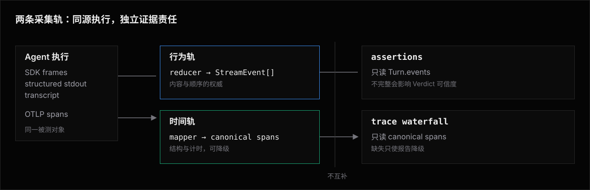

# Adapters —— 架构

Adapter 层隔离供应商协议。
core 只依赖 `Agent.send`、`Turn`、标准事件流和可选 tracing 声明，不识别 Claude、Codex、LangGraph 等名字。

## 数据流

```text
TurnInput
   │
   ▼
transport ──► raw frames / transcript
                  │
                  ▼
               reducer ──► StreamEvent[]
                  │
                  ▼
        session / HITL orchestration
                  │
                  ▼
                Turn
```

- **transport** 处理 URL、鉴权、CLI 和请求体，不抽象成通用 Agent 协议。
- **reducer** 把 SDK 事件、结构化 stdout 或 transcript 转成标准事件流。
- **orchestration** 使用 `ctx.session` 管理历史、ID 和暂停现场。

同一个 SDK 的 reducer 是稳定、可复用的协议知识，应放在独立转换器中；应用自己的 endpoint 与审批接口仍留在 Adapter 的 transport 粘合代码里。

## Attempt 取消与排空时序

公开取消原因与预算由 [Library](../library/README.md#attempt-取消与资源释放预算) 定义。
Attempt owner 让 deadline 与外部取消共用首次赢家 controller；先关闭 authoring，再通知 Attempt signal。
已裁定 timeout 后的外部取消不改原因，外部取消先赢时也不由迟到 timer 改判 timeout。
取消原因来自领域事实，不从异常名称、文案或上游任意 reason 推断。

整个 Attempt body 的真实 Effect interruption 归一化为 cancelled。
中断回调放在 execution race 外、资源 Scope 内；内部 race loser 的中断不能触发它。
回调仍先关闭 authoring，再通知同一个 controller，保留原 Cause，也不替换已裁定的 timeout。
Agent 的组合 send signal 不因此承诺 `AttemptSignal` 的窄 reason 类型。

执行与 cleanup 各在 Effect 实际开始执行时固定唯一计时起点。
运行时保存单调耗时，并从同一起点投影 Unix deadlineAt；timer 安装时只使用剩余量。
正常 Assertion seal 退役执行 timer，首次外部取消不提前消耗 cleanup 预算。

cleanup owner 对整个 LIFO 回调队列、晚到注册、已登记 handoff 和归档使用同一截止。
所有回调取得同一个冻结 context 和独立于执行取消的 signal，不逐项重启计时。
等待未结清 handoff 时，晚到 `onCleanup` 注册必须独立唤醒 drain，并重新检查 LIFO 队列。
释放不能等 handoff 自己结清后才开始，晚到回调或 handoff 也不能延长截止。

cleanup 完成或截止时，先关闭 usage 与 trace 接纳，再关闭附件入口，最后中止附件 producer 与 cleanup signal。
同步 abort listener 也不能越过采集关闭；迟到 Promise 不能修改采集器或已封存 Assertion。
cleanup 预算只扩大允许排空的时间，不增加采集权限，也不把 abort 当作物理请求完成回执。

## 行为轨与时间轨



OTel 内容字段可能被关闭或脱敏，因此 span 不补写 `Turn.events`。
行为轨不完整是契约缺失；时间轨缺失只是报告降级。

## 采集通道

按保真度优先选择：

1. 官方 SDK 事件或结构化结果，由官方转换器直接归一。
2. CLI 的结构化 stdout。
3. CLI 为 resume 保存的 transcript / tape。
4. 无结构化出处时返回空事件并明确负断言不可信，不从自然语言输出猜工具行为。

具体通道模型和新增 CLI 的检查清单见 [行为与 Trace 采集](collection.md)。

## Human live detail

Runner 在每次 `send` 开始时统一投影 `user: <message>`，Adapter 不重复从自己的 user event 提取正文。
这条短命 detail 只更新 Human `ACTIVE`，不进入 Record、JSON durable event 或 timeout error。

Adapter 只有在上游提供可证明的增量边界时才投影 `tool:` detail：

| Adapter | 可信的运行中边界 |
|---|---|
| Codex CLI | app-server item lifecycle，且 frame 同时匹配本次 native thread ID 与 turn ID |
| Claude Code | 双向 stream-json 中带完整 `id`、`name`、`input` 的 `tool_use`；每条 `result` 是本次 user frame 的 terminal barrier |
| UI Message Stream | 官方 reducer 已形成 `input-available` 或更后状态，并带完整 call ID、tool name 与 input |

Codex reasoning 与 assistant message 只显示泛化生命周期标签，不复制原始推理或回答正文。
Claude 与 UI Message Stream 按原生 call ID 去重，approval resume 不重报同一工具。

`aiSdkAgent(generateText)` 只取得终局结果，没有实时 transport seam。
OpenCode 与 OMP 的 Sandbox stdout callback 也不保证消费期间交付；Bub、Hermes、OpenClaw 与 DeepSeek Harness 只取得终局 transcript 或结果。
这些 Adapter 只获得 Runner 的 `user:` detail，不把退出后从 transcript 提取的工具事实伪装成实时进度。

Runner 在唯一 ACTIVE 出口先对完整文本做已知 secret redaction，再去除 VT、ANSI、C0 与 C1 控制字符并折叠空白。
控制字符移除与空白折叠后再次 redaction，最后在 grapheme 边界截到 256 UTF-8 bytes；Adapter 不预先截断可能含 secret 的字段。

## 标准事件不变量

1. 事件保持原始发生顺序，不按类型重排。
2. 工具调用与结果用稳定 `operationId` 配对；合成 ID 只作为不支持并发的最后回退。
3. `name` 保存原始名字，`tool` 保存跨 Agent 规范名。
4. 工具拒绝使用 `rejected`，执行故障使用 `failed`。
5. Skill 加载归一为 `skill.loaded`，不重复记成工具调用。
6. usage 缺失时不编造零以外的数字。

精确数据结构与状态不变量按主题拆分：

- [Agent 数据契约](agent-contract.md)
- [标准事件模型](events.md)
- [会话与 HITL 状态模型](session-state.md)
- [断言证据与完整性](evidence.md)
- [行为与 Trace 采集](collection.md)
- [Coding Agent 扩展边界](coding-agent-extensions.md)

## 小文件边界

每个 SDK 或 coding agent 在 [`sdk/`](../library/sdk/README.md) 下独立成页。
新增页面只描述该方言特有的事实：公开入口、原始事件形状、会话、HITL、usage、trace 与已知完整性边界。
通用数据结构与不变量只在 `architecture/` 定义；Library 页面只展示如何调用和组合。

外部源码阅读和行业调研放在 [Adapter Research](../../../research/adapters/README.md)，不会成为用户必须阅读的契约入口。

## 实现边界

| 责任 | 位置 |
|---|---|
| Agent / session / tracing 类型 | `src/agents/types.ts` |
| SDK 结果与事件转换器 | `src/agents/<protocol>.ts` |
| CLI transcript parser | `src/o11y/parsers/<agent>.ts` |
| OTLP 方言 mapper | `src/o11y/otlp/mappers/<agent>.ts` |
| Sandbox Agent 安装与驱动 | `src/agents/<agent>.ts` |
| 运行器调用、会话和 trace 归属 | `src/context/`、`src/runner/` |

新接一个对象时先判断协议知识能否独立于 transport。
如果能，先实现纯转换器和 fixture 测试，再编写薄 Adapter；不能，则保留为项目自己的手写映射，不把应用私有协议提升成 niceeval API。

## 轨迹领域标识与持久格式

`ExecutionTraceInput.schema` 只接收 `id`。领域标识不承担 Record 格式迁移职责；框架的 collection family revision 保持独立。
新写入的 header 和 Agent Turns 派生 header 都不合成领域 revision。历史 header 可以包含非负安全整数 `schema.revision`，
读取时保留原值与缺席状态，不回填、不转换 id，也不修改原始 Record。此次扩宽 header 读取规则沿用现有 family revision 1，
不新增迁移。旧读者不保证能读取缺少领域 revision 的新 header；后续不兼容格式变更另行治理。

事件的可选 `display` 同样在 family revision 1 内扩宽，不新增迁移。没有 `display` 的事件读取为 `display: absent`；
存在时按严格形状解码，未知 `kind`、未知字段或越过上限的值使 collection 为 invalid。`image` 块持久保存接纳时固定的
`artifactId`、`mediaType`、`byteLength` 与 `sha256`；发布与读取按 evidence 引用的同一规则验证附件闭合，
不符时返回 `inspection-record-integrity-failure`，不报成 `not-found`。旧读者不保证能读取带 `display` 的事件。


## 缓存读取率投影边界

[缓存读取率](../library/README.md#缓存读取率)由 Observability 的纯投影拥有，输入是已验证 Adapter usage 与冻结的 ResolvedModelSlots。
Runner 在读取 t.usage 时调用它，Inspection 在读取已发布 usage 后调用同一实现；Show 与 View 只格式化闭合报告。
公开类型随 EvalUsage 从根包与 expect 类型入口导出，Inspection codec 严格验证同一报告形状。

EvalUsage 在纯报告外提供冻结的 EvalCacheRead，rate(modelRole) 从该快照选择数值材料并统一处理缺失槽位。
选择函数不依赖 this 或可写 collector，Inspection、Show 与 View 继续消费纯报告，不接收函数。
报告仅派生，不写入新的 Attachment、数据表或 migration，也不改变旧 usage 字节。

聚合使用现有互斥桶语义，按调用先确定可信分母，再聚合；缺失分母不能用已知小计替代。
完整性是账本与每个调用的联合条件，不从 Verdict、费用或截断后的调用列表推断。
configured slots 提供空组身份，实际 provider/model 只来自调用事实；未知用途与未知模型保持 null。
每个冻结报告仅包含计数、理由与 rate，不保留对可写 collector 的引用；后续 cleanup 不改写已登记 Assertion。

验收从安装后的公开 Adapter、t.usage、query、show 与 View 进入。
验证 token 加权、多用途同模型、同用途多模型、输入总量优先、完整桶回退、缺项、零输入、空用途、partial/unsealed、失败重试及超出 128 条调用的全量聚合。
Query 与 Library 在同一采集截面逐字段一致，View 与 Show 展示同一数值和缺失原因；失败隔离保留已发布附件、usage 与已知 contribution。

独立原生 Codex / GPT-6.1 Sol 静态审查为 CONDITIONAL，以下三项已收敛。

attempt.usage 专属预算为 16 MiB（超限显式失败），不扩展 experiment.get 摘要。
读取边界传入 producerCompletenessKnown，revision 1–3 固定 false，当前 collector 为 true，仅影响 cacheRead。
unknown 状态计数单列并阻止 exact，不依赖输出 token 或成本。

验收加入 2000 组与最大身份字符串的公开 Query 可读（仍遵守现有附件 1 MiB 预算）、旧 revision complete 仍 unavailable、unknown 且 token 齐全仍 unavailable。


## 共享模型用途要求

model-slots 拥有声明校验、冻结与键集合归一化。Adapter 的绑定定义层保存 Eval 要求；Adapter 定义保存自身要求并为 create 提供精确的作者类型。
Experiment 归一化校验 Adapter 要求；统一 Eval selection 边界校验选中 Eval 的要求，CLI、SDK、dry 与执行使用同一判定。
requires 是用途集合，不是运行时模型注入或 adapter contract identity 的替代物。已有 Adapter contract token 仍验证应用操作相容性。

类型扩展通过带默认值的泛型与上下文替换保留旧调用。无 requires 的语义不变；带 requires 时只替换 usage.cacheRead.rate 与 Adapter models/recordUsage 的键类型。
不改变 Usage 持久化、Record schema、cacheRead 报告数组或调用计数语义。实际执行仍按 Experiment 已配置集合验证 modelRole；声明是最小前置要求，JavaScript 可使用额外已配置键。


独立 Codex 审查的根工厂边界、推导输入和运行时集合问题已收敛：仅扩展绑定工厂，requires.models 是唯一推导输入，运行时保持配置集合语义。
selection 接收完整 discovery 与规范化 models，校验整个 Experiment selector 集之后再筛 tag 和前缀；teardown 显式跳过新增要求校验。
不增加声明品牌；严格解码并复制冻结声明与键列表。验收保留 app、flags、assertions 组合和 JavaScript 非法输入，避免只验证简化示例。
