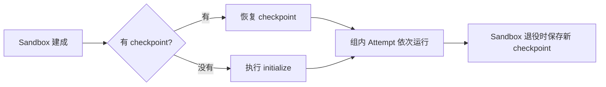

# State —— 跨 Attempt 保留的 Sandbox 状态

评估记忆系统、缓存或任何“越用越好”的 Agent 条件时，作者需要让同一组题目依次读写同一份状态：第 N 题能读到前 N−1 题写下的内容，下一次运行还能从上次结束的地方接着积累。State 把这件事声明成一个值：哪些 Sandbox 路径是要保留的状态、按什么 cohort 隔离，由 NiceEval 负责恢复、保存，并在 Run 中写明每条 Attempt 从哪份状态起步。

## 你可以做什么

- 声明 Sandbox 内要跨 Attempt 保留的目录，例如记忆库的数据目录。
- 在同一个 [Eval Group](../eval-groups/README.md) 里让后面的题读到前面的题写下的状态。
- 下一次运行从上次保存的状态继续；换一个 cohort 就从空状态重新开始。
- 在结果里看到每条 Attempt 从哪份状态起步、之前已经有几条 Attempt 写过它。
- 把状态和 Agent 扩展、准备步骤一起装进一个 [Plugin](../plugins/README.md)，在多个 Experiment 间复用。

## 上手

一个记忆工具把数据放在 `~/.mempal`。在 Experiment 上绑定它：

```ts
import { defineExperiment, defineState } from "niceeval";
import { codexAgent } from "niceeval/adapter";
import { dockerSandbox, shell } from "niceeval/sandbox";

const mempal = defineState({
  name: "mempal",
  version: "0.9.0",
  paths: ["~/.mempal"],
  initialize: shell({ command: "mempal init ~/.mempal" }),
});

export default defineExperiment({
  evals: ["react-hook-form/"],
  agent: codexAgent(),
  model: "gpt-5.6-luna",
  sandbox: dockerSandbox({ source: { type: "image", image: "memorybench-codex:1" } }),
  state: [mempal.bind({ cohort: "2026-11" })],
});
```

`react-hook-form/` 下的 Eval 已经由一个 `eval-group.ts` 组成 Eval Group。运行：

```sh
niceeval exp codex-mempal
```

预期输出中，每台 Group Sandbox 建成时报告恢复，退役时报告保存：

```text
  state mempal · react-hook-form  initialized (no checkpoint for cohort 2026-11)
  ...
  state mempal · react-hook-form  saved sha256:3f9a…c21e (1.4 MB)
```

再运行一次，同一 Group 从上次保存的状态起步：

```text
  state mempal · react-hook-form  restored sha256:3f9a…c21e (1.4 MB)
```

## 怎样工作

State 依附在 Eval Group 的物理 Sandbox 上。一个 Group 是一条 capacity-one lane，组内 Attempt 按顺序复用同一台 Sandbox；题间 reset 只恢复 workdir，State 的路径在 workdir 之外，所以组内后面的 Attempt 直接读到前面的 Attempt 写下的内容。



每份 State checkpoint 属于一条 State lineage，由 State 名称、`version`、State cohort、Experiment 与 Eval Group 五项共同决定。保存时 NiceEval 核对 lineage 当前的 checkpoint 仍是本台 Sandbox 恢复的那一份，不一致就不写入。Sandbox 因故障退役时不保存，下一台替代 Sandbox 从上一份已保存的 checkpoint 起步。

State 不作用于 Sandbox 外的服务。远程记忆服务等外部状态仍由作者用 Hook 管理，并用 Experiment 的 `sharedState.key` 防止并发运行互相干扰。

## 用户路径

- [在一组题里积累记忆](use-case/accumulate-in-group.md) —— 绑定 State，组内后题读到前题的状态，下次运行接着积累。
- [换一个 cohort 从空状态开始](use-case/start-new-cohort.md) —— 做正式对比时从干净状态起跑，旧 cohort 的 checkpoint 保留不动。
- [用 Plugin 复用记忆条件](use-case/state-in-plugin.md) —— 把 State、Agent skill 与准备步骤装进一个 Plugin，挂到多个 Experiment。

## 细节

- [Library](library.md) —— `defineState`、`bind`、挂载位置与定义期错误。
- [CLI](cli.md) —— `niceeval exp` 的状态反馈、`--dry` 计划与 `niceeval show` 中的状态起点。
- [Data Model](data-model.md) —— 持久实体、事务与离线事实。
- [Architecture](architecture.md) —— lineage、存储、保存时的比较、生命周期位置、结果携带与失败处理。
