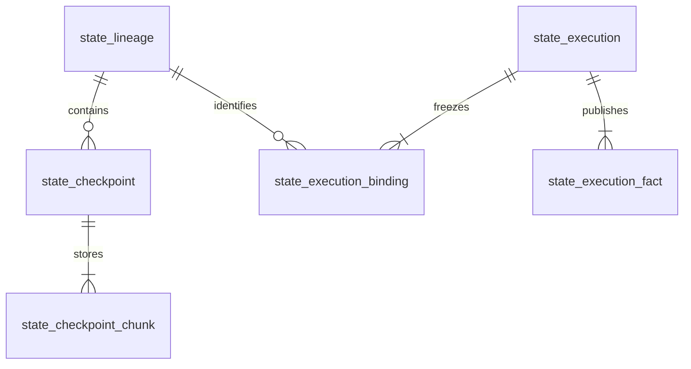

# State —— Data Model

State repository 属于 canonical ProjectDatabase；数据库的连接、格式准入与事务规则由 [Run storage](../run/architecture/storage.md) 拥有。
本页定义逻辑表，使用 SQLite STRICT；整数均非负且在 JavaScript safe integer 内，ID 与摘要由写入口严格解码。

## 实体与关系

每条 lineage 的 HEAD 指向自己的一个完整 checkpoint；没有 HEAD 即 fresh。
execution 对应一个 Run 的一台 Group 实例；binding 固定其 lineage 与 predecessor，fact 保存随 publication 前进的状态。
同一 execution 内全部 binding 共同提交，不能出现部分 saved。

## 表与约束

| 表 | 列与约束 |
| --- | --- |
| `state_lineage` | `id TEXT PRIMARY KEY`；`name, version, cohort, experiment_id, eval_group_id TEXT NOT NULL`；五项 UNIQUE；`head_id TEXT NULL` |
| `state_checkpoint` | `id TEXT PRIMARY KEY`；`lineage_id TEXT NOT NULL REFERENCES state_lineage(id)`；`execution_id, source_run_id, digest, manifest_json TEXT NOT NULL`；`bytes INTEGER NOT NULL`；`ready INTEGER NOT NULL CHECK(ready IN (0,1))` |
| `state_checkpoint_chunk` | `checkpoint_id TEXT NOT NULL REFERENCES state_checkpoint(id) ON DELETE CASCADE`；`ordinal INTEGER NOT NULL`；`bytes BLOB NOT NULL`；PRIMARY KEY(checkpoint_id, ordinal) |
| `state_execution` | `id TEXT PRIMARY KEY`；`run_id, experiment_id, eval_group_id TEXT NOT NULL`；`generation, writer_generation INTEGER NOT NULL`；`lease_set_id TEXT NOT NULL REFERENCES state_lease_set(id)`；UNIQUE(run_id, experiment_id, eval_group_id, generation) |
| `state_execution_binding` | `execution_id TEXT NOT NULL REFERENCES state_execution(id) ON DELETE CASCADE`；`ordinal INTEGER NOT NULL`；`lineage_id TEXT NOT NULL REFERENCES state_lineage(id)`；`predecessor_id TEXT NULL`；PRIMARY KEY(execution_id, ordinal)；UNIQUE(execution_id, lineage_id) |
| `state_execution_fact` | `execution_id TEXT NOT NULL REFERENCES state_execution(id) ON DELETE CASCADE`；`publication_sequence INTEGER NOT NULL`；`payload_json TEXT NOT NULL`；PRIMARY KEY(execution_id, publication_sequence) |

HEAD 与 predecessor 使用 `(lineage_id, checkpoint_id)` 复合约束，只能指向同 lineage；state_checkpoint 另设 UNIQUE(lineage_id, id)。
head_id 只允许指向 ready=1 的 checkpoint，由同一具名 repository 的事务校验保证。所有非 nullable 列不使用空字符串表示缺失。
execution_id 与 source_run_id 在 checkpoint 中是不可变历史出处，不加反向级联外键；删 Run 不能删 checkpoint。

最终保存事务校验 source_run_id 等于 execution.run_id；出处 Run 删除后，只校验保留 ID 的格式与 checkpoint 自身完整性，不要求已删 execution 仍能 join。

`manifest_json` 严格形状为 `{ roots: [{ declared, resolved, present }] }`，三个字段分别为规范化声明 string、绝对路径 string、boolean。
roots 按 declared 排序；每个归档成员使用根序号与相对路径。解码与文件访问均执行 [路径规则](library.md#路径边界)。
`payload_json` 严格解码为 StateExecution；内容必须与 execution/binding 固定身份一致，不接受任意 JSON 扩展。

索引 `state_execution(run_id, experiment_id, eval_group_id, generation)` 支持 Run query；fact 主键支持每 execution 在 cutoff 下取最新版本。
checkpoint 增加 `(execution_id, lineage_id)` UNIQUE，支持 commit ack 丢失后的精确重读；digest 不设唯一，避免把同内容误当同一次提交。
State 表服从整个 Record 的唯一格式标记与 hostile reader allowlist。格式不兼容时拒绝打开，不建立独立格式标记或迁移链。

## 写入与发布

1. 全部租约取得后，读取并冻结 predecessor。acquire 成功后以 Run writer generation 建立 execution/bindings 和 pending fact。
2. 所有恢复完成后追加 ready fact；失败追加 failed/skipped fact。每次追加走 Run publication sequence。
3. capture 流式写入 ready=0 的 checkpoint 与连续 chunk；每块最多 1 MiB，不把完整归档留在内存或长事务中。
4. capture 完成后校验连续 ordinal、总字节数、digest 与 manifest。只有全部 checkpoint 完整，才进入最终短事务。
5. 最终事务校验 Run active writer、全部 lease generations、predecessor 与 ready 状态；置 ready=1、推进全部 HEAD、追加 saved fact，作为一个 publication commit。

staging bytes 在事务外产生、以短 batch 存入库；只有最终事务令其可恢复。任何失败或中断都不能使 ready=0 的内容成为 HEAD。
重试只重新提交冻结写命令；不重跑作者初始化或文件读取。commit identity 为 executionId，其 binding 集合、predecessor 与新摘要必须完全一致。

数据库忙按 Run 的写入预算重试；预算耗尽或容量不足是失败，不能把不完整 archive 标为 ready。
恢复先通过 exact executionId 确认是否已有 saved fact；有则禁止再保存，没有且原 owner 终止时发布 skipped/recovered。
staging 回收只删除已证明无活动 owner、且没有 HEAD 引用的 ready=0 行；不得按年龄接管 owner。

## Run 与 portable Record

Run 事实、HEAD 与 checkpoint 都在同一个 canonical 文件；portable gate 不生成过滤副本或第二份 SQLite。
进入 portable 前须无活动 State execution、未决提交、staging bytes 或未释放租约。已证明无 owner 的 staging 按恢复规则删除，不能绕过 gate。
完整 checkpoint、HEAD 与终结事实可随文件移动；只读 Inspection 读取不返回 archive 内容或私有 manifest，也不访问远端 Sandbox。

Run hostile reader 的精确 schema allowlist 加入这些表、索引与外键，验证 manifest/JSON 形状和 publication closure。
按有界 chunk 验证内容，不一次载入全部 archive；不解包、不执行 initialize。外部 `--record` 私有捕获仍是只读事实输入，不变成项目 authority。

Run 删除须先证明关联集合 free，再只删该 Run 的 execution、binding 与 fact；checkpoint 的历史出处 ID 可以指向已删 Run，读面不得据此声称该 Run 仍可读取。
canonical HEAD 与 ready checkpoint 保留，后续运行仍可恢复。当前格式内的缺失事实按 unavailable 读取，不推断已保存或从空状态开始；旧格式在读取前拒绝。
